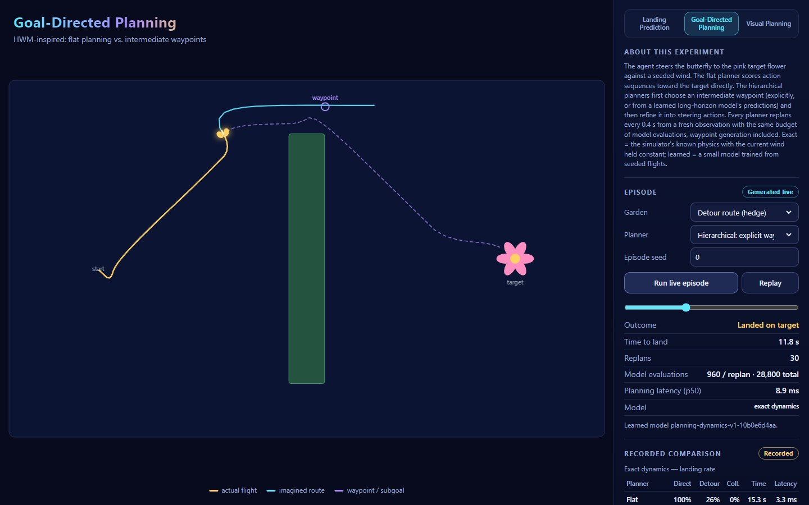
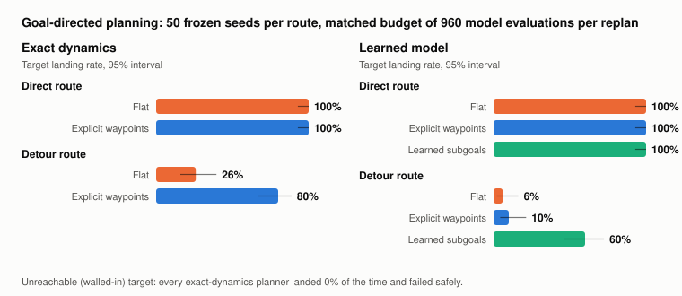
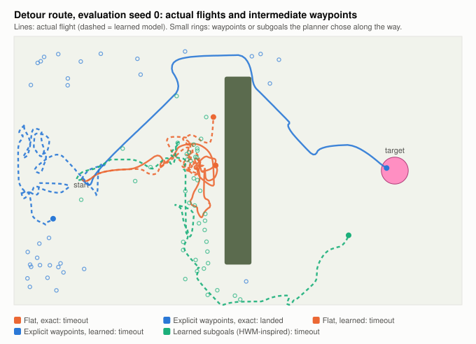

# Goal-Directed Planning (V1.1, Phase 1) — HWM-inspired

*Developed and built by Oren Salami · V1.1*

In the original mode the butterfly decides where to fly and a model only watches. In this opt-in mode an **agent steers** the butterfly and has to land on one designated target flower. The question is the one asked by *Hierarchical Planning with Latent World Models* (HWM): when a direct approach is a trap, does planning through **intermediate waypoints** beat planning toward the goal directly, under the same compute budget?

This is an **inspired adaptation**, not a reproduction. The garden is two-dimensional and tiny, the actions are discrete, and the learned model is a small MLP over states, not a latent model over images (that is Phase 2).

## The controlled garden

| | |
|---|---|
| Code | `api/planning/garden.py` (simulator), `models.py` (transition models), `planners.py`, `episode.py`, `learned.py`, `evaluation.py` |
| World | 100 × 60 units, the same physics constants as the prediction mode (`api/params.py`) |
| Actions | 16 steering actions: 8 headings × {cruise 11 u/s, slow 4 u/s}. One action is held for one *decision* = 2 simulator steps = 0.2 s |
| Wind | Seeded per episode: a mean wind (0–6 u/s, any direction) plus an Ornstein–Uhlenbeck gust, one vector per simulator step |
| Landing | Inside the target's 3-unit radius at ≤ 9 u/s. Entering an obstacle ends the episode as a collision. Limit: 120 decisions (24 s) |
| Routes | **direct** — a bush sits off to the side; **detour** — a hedge blocks the straight line, gaps only at the top and bottom edges; **enclosed** — the target is walled in (unreachable, used to check safe failure) |

The simulator (`ControlledFlight`) owns the true state and the whole wind schedule. Planners receive a `FlightObservation` only: position, velocity, the wind **right now**, and the decision counter. They never see future gusts.

## Planners

All planners replan every 2 decisions (0.4 s) from a fresh observation and spend exactly **960 transition-model evaluations per replan** (`BUDGET`, asserted in code and in `tests/test_planning.py`). One evaluation = one model prediction for one candidate.

| Planner | High level | Low level | Evaluations per replan |
|---|---|---|---|
| **Flat** | — | Random shooting, 64 sequences × 15 decisions (3 s) toward the target, warm-started from the previous plan | 960 |
| **Explicit waypoints** | 16 candidate waypoints (the target, the current waypoint, 14 random points); each scored by a 30-decision coarse rollout "fly to the waypoint, then to the target" | Random shooting, 32 × 15, toward the chosen waypoint (or the target when it is the best candidate) | 480 + 480 |
| **Learned subgoals** (HWM-inspired, learned model only) | 160 sequences of 3 macro-actions (one action held for 8 decisions = 1.6 s), rolled out with the **longer-horizon** learned model; the predicted state after the first macro-action becomes the subgoal | Random shooting, 32 × 15, toward the subgoal (toward the target when within 18 units) | 480 + 480 |

Rollout cost: landing early is best; otherwise remaining distance; a collision costs 1000 × the rollout's **peak** per-decision collision probability (0 or 1 for exact dynamics).

### Transition models

- **Exact dynamics** (`ExactModel`): the documented physics, with the currently observed wind held constant. This is the first, controlled comparison.
- **Learned model** (`LearnedModel`): trained by `python -m experiments.train_planning` from 3,000 seeded exploration trajectories (chains of random macro-actions from random start points, both learned layouts). Two heads, same architecture (24 → 128 → 128 → 5, ReLU):
  - *short*: state change after one decision + collision logit;
  - *long*: state change after one macro-action (8 decisions) + collision-within-macro logit.
  Collision examples are rare (0.3% per decision), so the collision loss weights positives 10× and the logit is shifted back by log 10 at inference, giving calibrated probabilities. Validation (400 held-out trajectories): position RMSE 0.12 units (short), 1.10 units (long); collision recall 0.77 / 0.90.

## Results

`python -m experiments.run_planning` — 50 frozen evaluation seeds per route (`PLANNING_EVAL_SEEDS = 0..49`), identical start states, wind seeds and budgets for every planner. Learned model `planning-dynamics-v1-10b0e6d4aa`.

**Exact dynamics**

| Route | Planner | Landed (95% CI) | Collisions | Mean time to land | High-level share of evaluations | Latency p50 / replan |
|---|---|---|---|---|---|---|
| Direct | Flat | 100% (93–100) | 0% | 8.2 s | 0% | 1.4 ms |
| Direct | Explicit waypoints | 100% (93–100) | 0% | 8.9 s | 50% | 9.2 ms |
| Detour | Flat | **26%** (16–40) | 0% | 15.3 s | 0% | 3.3 ms |
| Detour | Explicit waypoints | **80%** (67–89) | 0% | 16.7 s | 50% | 9.3 ms |
| Enclosed | Flat / waypoints | 0% / 0% | 0% / 0% | — | — | 3.4 / 10.3 ms |

**Learned model** (reported separately)

| Route | Planner | Landed (95% CI) | Collisions | Mean time to land | Latency p50 / replan |
|---|---|---|---|---|---|
| Direct | Flat | 100% (93–100) | 0% | 8.2 s | 6.2 ms |
| Direct | Explicit waypoints | 100% (93–100) | 0% | 9.0 s | 8.0 ms |
| Direct | Learned subgoals | 100% (93–100) | 0% | 11.6 s | 4.2 ms |
| Detour | Flat | 6% (2–16) | 0% | 14.3 s | 5.4 ms |
| Detour | Explicit waypoints | 10% (4–21) | 0% | 17.3 s | 3.5 ms |
| Detour | **Learned subgoals** | **60%** (46–72) | 0% | 19.5 s | 2.0 ms |

### What this shows

- On the **direct** route hierarchy buys nothing: every planner lands every time, and the flat planner is fastest and cheapest.
- On the **detour**, the flat planner's 3-second horizon cannot see past the hedge, so it hovers in front of it (a local minimum) and mostly times out. Spending half the same budget on waypoints lifts the landing rate from 26% to 80% with exact dynamics.
- With the **learned** model, explicit waypoints mostly fail (10%): their 30-decision coarse rollouts chain the one-step model 30 times, and its blurred collision boundary near the hedge ends makes the gaps look risky. The **learned long-horizon subgoals** need only 3 predictions per candidate route and reach 60% — the HWM argument that a higher-level model which predicts *farther per step* is what makes long-horizon planning tractable.
- No planner collided. On the unreachable target every planner timed out safely.
- Hierarchy costs latency: the waypoint planner spends about 9 ms per replan with exact dynamics versus 1–3 ms for flat. With the learned model the subgoal planner is the cheapest, because its high level calls the long head only 480 times.

## Method notes

- **Frozen seeds.** `api/planning/seeds.py` fixes evaluation (0–49), tuning (50,000–50,009), training (200,000–202,999) and validation (300,000–300,399) ranges. All design choices (peak-risk collision cost, logit correction, waypoint hysteresis) were made on tuning seeds only. Tests assert the ranges are disjoint.
- **Data split.** Learned-model data are split by whole trajectory and by seed range; trajectories end at their first collision.
- **Repeatability.** An episode is fully determined by (route, planner, seed, model artifact); only latency varies. `tests/test_planning.py` checks this.
- **Evidence.** Each run exports `metrics.json` (seeds, config, model version, validation metrics, generated time), `episodes.csv` (one row per episode) and the two charts to `experiments/results/planning/`. The model artifact is `artifacts/planning/dynamics.npz` + `dynamics.json`.

## Limitations

- Fifty seeds per route: the confidence intervals are wide (±10–15 points).
- The explicit-waypoint planner proposes random points; a smarter proposal (e.g. a sampled roadmap) would likely do better and was not explored.
- Exact-dynamics planners assume the current wind persists; they do not model gusts.
- The learned model is trained on the same two layouts it is evaluated on (different seeds, starts and winds, but not new gardens). It is not tested on unseen layouts and does not support the enclosed layout.
- One learned-model training seed. Phase 2 reports several.

## Sources

- Zhang et al., [*Hierarchical Planning with Latent World Models*](https://arxiv.org/abs/2604.03208).
- [Hierarchical World Model Planning](https://github.com/Oren1984/hierarchical-world-model-planning) — reference for the local benchmarking methodology (matched budgets, frozen seeds).
