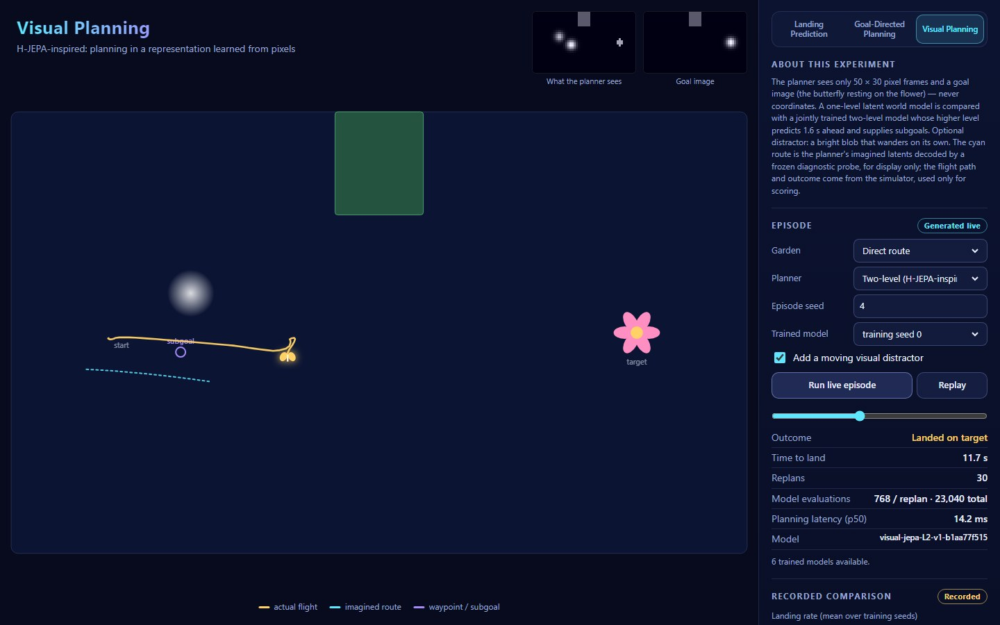
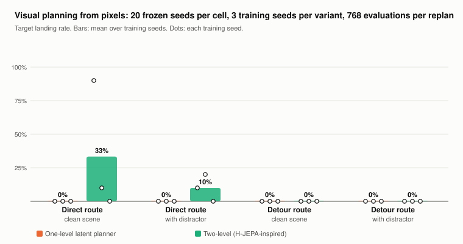

# Visual Planning (V1.1, Phase 2) — an H-JEPA-inspired adaptation

*Developed and built by Oren Salami · V1.1*

**Label: H-JEPA-inspired adaptation.** This is a small CPU experiment that borrows the *idea* of *H-JEPA — End-to-End Learning of Hierarchical World Models for Visual Planning*: learn action-conditioned predictors in a representation learned from pixels, stack a higher level that predicts farther ahead, and use its predictions as subgoals. It does not reproduce the paper's architecture, scale, data or results.

## Setting

- **Same controlled garden as Phase 1** (direct and detour routes, 16 steering actions, 0.2 s decisions), with wind at half strength. Episodes last at most 100 decisions (20 s).
- **Frames:** 50 × 30 grayscale pixels (2 world units per pixel) showing the obstacles, the target flower, the butterfly (a blob about 1.5 px wide) and, optionally, the **distractor** — a blob of the same size, slightly dimmer, wandering on its own seeded random walk, independent of the agent's actions.
- **What the models and planners receive:** the previous and current frame (so velocity is visible), the actions, and a **goal image** (the butterfly resting on the flower, no distractor). Simulator coordinates are never an input at evaluation time. Ground truth is used only to render frames, to score landings, and to fit the diagnostic probe.

Code: `api/visual/scene.py` (rendering, distractor, data), `jepa.py` (models, training, probe), `planners.py`, `episode.py`; commands `experiments/train_visual.py`, `experiments/run_visual.py`.

## Models

| | One-level | Two-level (trained jointly) |
|---|---|---|
| Encoder | MLP 3000 → 256 → **z** (32-d) | the same, plus its own higher-level encoder z → 64 → **h** (16-d) |
| Predictor | (z, action) → z after one decision, plus a collision logit | the same, plus (h, macro-action) → h after **8 decisions (1.6 s)**, plus a collision-within-macro logit |
| Subgoals | — | projection G: h → z turns a predicted h into a low-level subgoal |
| Parameters | 787k | 797k |

A macro-action is encoded as the mean one-hot of the 8 actions it spans, so the planner can use "hold one action for 1.6 s".

### Objective

A joint-embedding predictive objective: the predictor must match the **target encoder's** embedding of the future frame pair. Pixels are never reconstructed.

`loss = MSE(P(z_t, a_t), sg(Ē(x_{t+1})))  +  var(z) + 0.04·cov(z)  +  0.2·BCE(collision)`

For the two-level model, add the same terms one level up (`MSE(P_h(h_t, m_t), sg(Ē_h(Ē(x_{t+8}))))`, variance and covariance on h, collision-within-macro) plus `0.5·MSE(G(h_t), sg(Ē(x_t)))`. Both variants see exactly the same trajectories, batch size (128) and number of Adam steps (3,000).

### How representation collapse is prevented and monitored

- **Stop-gradient targets.** Target encoders Ē and Ē_h are exponential moving averages (τ = 0.99) of the online encoders and receive no gradient.
- **VICReg-style regularisation** on z and h: a hinge pushes every dimension's standard deviation up to 1, and a covariance penalty decorrelates dimensions.
- **Monitoring.** Every 250 steps, on a fixed batch of validation frames: mean per-dimension standard deviation and effective rank of z and h, plus validation prediction loss. A run is flagged *collapsed* if the mean std falls below 0.1 or the effective rank below 2, and *unstable* if the loss turns non-finite or the validation loss climbs above 3× its best. The curves are saved in each artifact's JSON.
- **Outcome.** No run was flagged. Final effective rank: z ≈ 28 of 32, h ≈ 15 of 16, for all six runs.

## Planners (matched budget: 768 predictor evaluations per replan)

- **One-level:** random shooting, 64 sequences × 12 decisions, cost = closest approach to the goal embedding + 0.5 × final distance + collision risk.
- **Two-level:** the high level searches 64 sequences of 2 macro-actions with the high-level predictor toward the goal's h (128 evaluations). The predicted h after the first macro-action is projected to a low-level subgoal. The low level then searches 64 × 10 (640 evaluations) toward that subgoal, plus 0.5 × final distance to the goal.
- Both replan every 2 decisions, from fresh frames.

## Data split

- 700 training trajectories (seeds 400,000–400,699) and 120 validation trajectories (500,000–500,119), split by **whole trajectory** and disjoint seed ranges. Half of them carry a distractor.
- The evaluation episodes use the frozen `VISUAL_EVAL_SEEDS` (0–19) with a different random stream. Design choices were checked only on `VISUAL_TUNE_SEEDS` (60,000–60,009).
- Training stops at a trajectory's first collision: no example ever continues past one (`tests/test_visual.py`).

## Results

`python -m experiments.run_visual` — 20 frozen seeds × 2 routes × {clean, distractor} × 2 variants × 3 training seeds = 480 episodes.

**Landing rate** (mean over training seeds 0 / 1 / 2, with each seed in brackets)

| Variant | Direct, clean | Direct, distractor | Detour, clean | Detour, distractor |
|---|---|---|---|---|
| One-level | 0% (0 / 0 / 0) | 0% (0 / 0 / 0) | 0% | 0% |
| Two-level | **33%** (90 / 10 / 0) | 10% (10 / 20 / 0) | 0% | 0% |

- **Change under distraction (two-level, direct):** −23 points, and collisions rose from 0% to 17%.
- **Detour collisions:** one-level 5% clean / 8% with distractor; two-level 3% / 37%.
- **Planning latency:** about 1.5–1.7 ms per replan for both variants.

**Frozen diagnostic probe** — a linear ridge read-out fitted on training trajectories and scored as R² on held-out validation trajectories, averaged over training seeds:

| Representation | Butterfly position R² | Distractor position R² |
|---|---|---|
| One-level z | 0.70 | 0.27 |
| Two-level z | 0.75 | 0.26 |
| Two-level h | 0.72 | 0.27 |

### What this shows — and what it does not

- Planning from pixels is **much harder** than planning from states. On the direct route the one-level planner never landed: its latent distance to the goal image does not guide it closely enough to slow down on the flower within 20 s.
- The two-level planner did land, but **unreliably**. One training seed lands 90% of clean direct episodes; the other two land 10% and 0%. The mean (33%) hides that spread, which is why every seed is reported. With three seeds this is a weak signal in favour of the hierarchy, not a demonstration.
- **Neither variant solved the detour.** The learned collision heads were not enough to steer around the hedge from pixels.
- The distractor **hurts** the two-level planner (−23 points, more collisions) even though the representations keep little linear information about it (R² ≈ 0.27 against ≈ 0.72 for the butterfly). Low read-out of the distractor did not make planning robust to it.
- **A development failure worth noting.** With a 1-pixel butterfly, even a linear read-out of *raw pixels* reached only R² 0.17 for its position. The first trained encoder kept more distractor than butterfly information (R² 0.64 vs 0.32), and planning failed everywhere. Making the butterfly ~1.5 px wide fixed the representation (pixel read-out R² 0.83). All reported runs use the larger rendering.

The replay in the app draws a cyan "imagined route". It is the planner's imagined latents decoded by the frozen probe, **for display only** — the planner never uses the probe. An animation of state-based planning would be a visualisation; here the predictions are genuinely learned from pixels.

## Evidence

- `experiments/results/visual/metrics.json`: seeds, config, every model version, per-cell and per-seed results, probe scores, training health, flagged runs.
- `experiments/results/visual/episodes.csv`: one row per episode.
- `experiments/results/visual/comparison.svg`: the chart.
- `artifacts/visual/<variant>_seed<k>.npz/.json`: weights, plus model version, config, training curve, collapse checks and probe scores.

## Limitations

- Tiny MLP encoders on 50 × 30 frames, three training seeds, 20 evaluation seeds per cell: wide uncertainty and large seed-to-seed variance.
- Random-shooting planners in latent space. A gradient-based or CEM optimiser might do better; it was not tried.
- The goal image and the training data come from the same two gardens; nothing tests unseen layouts.
- Wind is invisible in the frames, so it acts as unobserved noise.
- The collision heads are a pragmatic addition (a "continue" predictor, as in Dreamer-style world models); H-JEPA itself does not use them.

## Sources

- Zhang et al., [*H-JEPA — End-to-End Learning of Hierarchical World Models for Visual Planning*](https://h-jepa.com/).
- Zhang et al., [*Hierarchical Planning with Latent World Models*](https://arxiv.org/abs/2604.03208).
- Bardes, Ponce and LeCun, [*VICReg*](https://arxiv.org/abs/2105.04906) (2022) — the variance and covariance regularisers.
